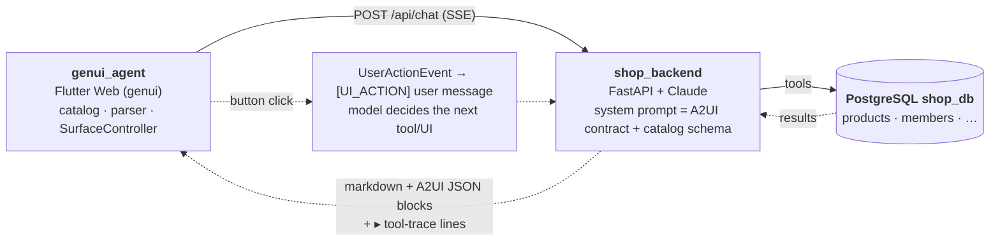

# GenUI Shopping Assistant

> **Just talk. The UI builds itself.** A conversational shopping demo in which the LLM answers with *dynamic UI, not just text*: it decides which UI fits each question and a Flutter app renders that choice as native widgets in real time — built on [flutter/genui](https://github.com/flutter/genui) (A2UI v0.9) and Claude.

[한국어 README](README_ko.md) · [Demo video](https://simonryu21.github.io/genui-conversational-shop/demo.mp4) · [Slides (EN)](https://simonryu21.github.io/genui-conversational-shop/slides_en.html) · [슬라이드 (KO)](https://simonryu21.github.io/genui-conversational-shop/slides_ko.html)

## What this project set out to prove

▶ **[Watch the demo video](https://simonryu21.github.io/genui-conversational-shop/demo.mp4)** (mp4, ~7 MB)

Two questions drove this project:

1. **Does generative UI actually work today?** Not as a concept, but end to end: a real LLM, a real PostgreSQL database, and the flutter/genui A2UI SDK rendering whatever the model decides to show, with no screen coded per scenario.
2. **What does it change in a conversational shop?** Chat agents are good at words. Are they also good at choosing *how* to show an answer so that a person understands it at a glance?

Both answers turned out to be yes. The model does not just talk well; it picks the UI a person understands fastest.

| You say | The model calls | What appears |
|---|---|---|
| "Recommend winter camping gear with my remaining points" | `get_member` → `get_purchase_history` → `search_products` ×2 | **ProductGrid** — 3 cards with the reason for each pick, a set total and an add-all button |
| "Compare the two sleeping bags" | `get_product_specs` | **ComparisonTable** — spec rows side by side, an Add button per column |
| "Recommend canned tuna" (36 results) | `search_products` | **Interview form** — two quick questions built from standard parts instead of a 36-item list |
| "How many points do I have left?" | none (reused the earlier result) | **Text only** — the model decided nothing needed drawing |
| Click **Add** → **Proceed to checkout** → **Confirm payment** | `add_to_cart` → `submit_order` → `confirm_payment` | **CartSummary** → **OrderConfirmation** — each click becomes the next turn |

Everything above came from one chat window with the Flutter code frozen. The developer defines a **catalog** of four domain components plus the SDK's standard parts; the model assembles the UI from those parts based on what the database returned. Verified against a real LLM and a real database with **zero Flutter code changes** between scenarios — see [docs/verification](docs/verification/README.md).

## What gets better compared with text-only chat

- **Fewer round trips.** When 36 products match, the model asks two quick questions in a form instead of listing everything or guessing.
- **Less typing.** Buttons inside the generated UI feed back into the conversation as the next turn: Add, Proceed to checkout, Confirm payment.
- **Information in shapes people already know.** A shortlist is a card grid, a comparison is a table, a cart is a cart. Nothing has to be read out of a paragraph.
- **The app keeps its design system.** Shape, color and spacing live in Flutter code; the model fills in content only, and it can only use parts the app has granted.

## Architecture



- **A2UI is a prompt specification, not a model feature.** The system prompt teaches the model the message format and the catalog schema; the client validates every message before rendering. Swap the LLM and the app stays the same.
- **Human-in-the-loop by construction.** Add-to-cart and order submission live in session memory only. The single DB write (`confirm_payment`) requires three explicit user clicks and is guarded by server-side state checks, not just the prompt — see [docs/hitl.md](docs/hitl.md).
- **Tool traces are real.** The `▸ search_products(…)` lines in the chat are generated from actual `tool_use` events, never by the model.

## Projects

| Directory | What it is | Stack |
|---|---|---|
| [`shop_backend/`](shop_backend/) | Agent server: streaming tool loop, 8 strict-schema tools, in-memory sessions, JSONL turn logs | Python 3.10+, FastAPI, Anthropic SDK, psycopg |
| [`genui_agent/`](genui_agent/) | Web client: custom catalog (4 components), SSE client, offline scripted mock | Flutter 3.10+ (web), genui 0.10.x |
| [`docs/`](docs/) | Architecture, HITL walkthrough, SDK notes, verification logs, slides | Markdown / HTML |

## Prerequisites

- Python 3.10+ and PostgreSQL 14+ running locally
- Flutter SDK (stable) with Chrome for web builds
- An Anthropic API key (`ANTHROPIC_API_KEY`) — or AWS credentials if you choose the Bedrock provider

Unless stated otherwise, each setup section starts at the repository root.

## Quick start — run the backend and the web client

Two terminals. Details for each step are in sections 1 and 2 below.

```sh
# Terminal 1 — backend (FastAPI, port 8010)
cd shop_backend && pip install -r requirements.txt && cp .env.example .env   # edit .env
python scripts/init_db.py && sh run_server.sh        # Windows: run_server.bat

# Terminal 2 — web client (Flutter Web, opens Chrome)
cd genui_agent && flutter pub get && flutter run -d chrome
```

Open the ⚙ menu in the app header to switch the demo language (Korean / English).

## 1. Backend: `shop_backend`

```sh
cd shop_backend
pip install -r requirements.txt
cp .env.example .env            # then edit: DATABASE_URL, ANTHROPIC_API_KEY, DEMO_LANGUAGE (ko|en)
python scripts/init_db.py       # creates shop_db, applies schema.sql + seed.sql (idempotent)
python scripts/fetch_seed_data.py   # optional: adds a few hundred real products (Open Food Facts; data.go.kr if you have a key)
sh run_server.sh                # or run_server.bat on Windows → http://127.0.0.1:8010
```

Check `GET http://127.0.0.1:8010/api/health` — it reports the DB, product count, provider, default language and whether the API key is set.

Settings are read from `.env`, then overridden by an optional `.env.local` (git-ignored). Keep anything personal or company-specific (Bedrock account, internal gateway, profile names) in `.env.local` only.

LLM provider is selected in `.env`:

| `LLM_PROVIDER` | Client | Credentials | Default model |
|---|---|---|---|
| `anthropic` (default) | `anthropic.Anthropic()` | `ANTHROPIC_API_KEY` | `claude-opus-5-5` |
| `bedrock` | `anthropic.AnthropicBedrock()` | standard AWS credential chain (`AWS_PROFILE` or access keys), `BEDROCK_REGION`, optional `BEDROCK_BASE_URL` | `global.anthropic.claude-opus-5-5` |

### Testing with AWS Bedrock (company values stay out of git)

```sh
cd shop_backend
cp .env.bedrock.example .env.local      # git-ignored overlay — put the company profile / keys / gateway URL here
aws sso login --profile <your-profile>  # or paste temporary keys into .env.local
sh run_server.sh                        # /api/health now shows aws_creds + the caller ARN
```

- `.env.local` overrides `.env`, so the tracked `.env` can stay on the Anthropic provider while you test Bedrock locally.
- Corporate network options (`BEDROCK_BASE_URL`, `HTTPS_PROXY`, `SSL_CERT_FILE` / `AWS_CA_BUNDLE`) are documented in `.env.bedrock.example`. Certificates and company scripts belong in `shop_backend/local/` or any `*.local.*` file — both are ignored by git.
- `python shop_backend/scripts/check_secrets.py` scans staged files for AWS/Anthropic keys, private keys, account IDs in ARNs and forbidden paths. Enable it as a pre-commit hook with `git config core.hooksPath .githooks`. Company-specific words to block (company name, internal domains, account IDs) go one per line in a git-ignored `.secretpatterns.local` at the repo root.

Tests run against the live database and restore anything they write:

```sh
cd shop_backend && pytest tests/test_tools.py -v
```

## 2. Web client: `genui_agent`

```sh
cd genui_agent
flutter pub get
flutter run -d chrome                                   # connects to http://localhost:8010
flutter run -d chrome --dart-define=BE_URL=http://host:8010
flutter run -d chrome --dart-define=DEMO_LANG=ko           # start in Korean (default: en)
```

Try the prompts from the table above and press **Add** on a card to see a UI event become the next turn.

**Language.** The ⚙ menu in the header switches the demo between Korean and English at runtime: the suggestion chips, hints and action labels change immediately, and every following request carries `lang`, which makes the backend pick the matching system prompt so the model answers in that language. Both the app and the server default to English; the server-side default is `DEMO_LANGUAGE` in `.env`. The seed catalog itself is Korean, so in English mode the model describes products in English and may keep the original Korean name in parentheses.

## 3. Offline mode (no backend, no API key)

```sh
cd genui_agent
flutter run -d chrome --dart-define=AGENT_MODE=scripted
flutter test                                            # widget tests use the scripted agent automatically
```

The scripted agent emits the *same* text + A2UI stream format as the LLM, so the full parse → validate → render → action loop is exercised without a model. Its canned replies are Korean only; the English suggestion chips still route to the same scenarios.

## Verification results

Three scenarios were run with the Flutter code frozen — different query conditions, a live DB price change, and an off-script request. All three produced different, correct UIs; the model also recovered from an empty search by widening its own filter. For "recommend canned tuna" it built a form the catalog never defined and invented its own action name, then read that action back on the next turn. Raw SSE logs and the summary are in [docs/verification](docs/verification/README.md).

## Documentation

- [Slides (English)](https://simonryu21.github.io/genui-conversational-shop/slides_en.html) · [슬라이드 (한국어)](https://simonryu21.github.io/genui-conversational-shop/slides_ko.html) — open in a browser; ← → to navigate, N for speaker notes
- [docs/architecture.md](docs/architecture.md) — full design: tools, DB schema, LLM settings, prompt strategy, API contract, sessions (Korean)
- [docs/hitl.md](docs/hitl.md) — where and how human-in-the-loop is enforced in code (Korean, with Mermaid diagrams)
- [docs/flutter_genui_sdk.md](docs/flutter_genui_sdk.md) — notes on the genui 0.10.x SDK internals and pitfalls (Korean)

## Public repository maintenance

- Never commit `shop_backend/.env` or `.env.local`; only the `*.example` templates are tracked. Turn logs (`shop_backend/logs/`) are ignored.
- Company-specific material (Bedrock accounts, gateway URLs, CA certificates, SSO scripts) lives only in `.env.local`, `*.local.*` files or `local/` directories — all git-ignored. Run `python shop_backend/scripts/check_secrets.py --all` before publishing, or install the hook with `git config core.hooksPath .githooks`.
- The seed member and purchase history are fictional. External product data is fetched at setup time and not redistributed here.
- `genui` is **highly experimental**; minor versions break. `pubspec.lock` pins the versions this demo was verified with.

## License

[MIT](LICENSE). The `genui` SDK is BSD-3-Clause (Flutter team). Product data sources: [Open Food Facts](https://world.openfoodfacts.org) (ODbL) and, optionally, the Korea Consumer Agency price API via [data.go.kr](https://www.data.go.kr).
