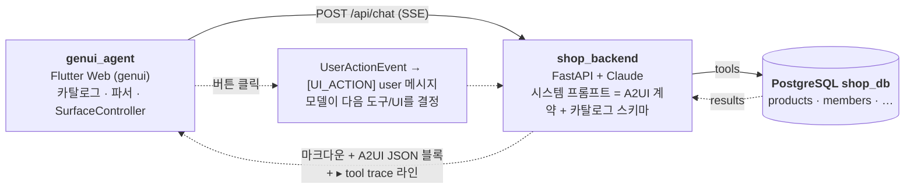

# GenUI 쇼핑 어시스턴트

> **말만 하면 UI가 만들어진다.** LLM이 *텍스트만이 아니라 동적 UI로* 답하는 대화형 쇼핑 데모. 질문마다 어떤 UI가 맞는지 모델이 스스로 고르고, Flutter 앱이 그 선택을 네이티브 위젯으로 실시간 렌더링한다 — [flutter/genui](https://github.com/flutter/genui)(A2UI v0.9) + Claude.

[English README](README.md) · [데모 영상](https://simonryu21.github.io/genui-conversational-shop/demo.mp4) · [슬라이드 (KO)](https://simonryu21.github.io/genui-conversational-shop/slides_ko.html) · [Slides (EN)](https://simonryu21.github.io/genui-conversational-shop/slides_en.html)

## 이 프로젝트가 확인하려던 것

▶ **[데모 영상 보기](https://simonryu21.github.io/genui-conversational-shop/demo.mp4)** (mp4, 약 7MB)

질문은 두 가지였다.

1. **GenUI는 지금 실제로 되는가?** 개념이 아니라 끝까지. 실제 LLM, 실제 PostgreSQL, 그리고 flutter/genui의 A2UI SDK가 모델이 보여 주기로 한 것을 그대로 렌더링하는지. 시나리오별로 미리 짜 둔 화면 없이.
2. **대화형 쇼핑몰에 적용하면 무엇이 좋아지는가?** 챗봇은 말을 잘한다. 그런데 답을 *어떻게 보여 줄지*도 잘 고를 수 있을까? 사람이 한눈에 이해할 수 있게.

둘 다 그렇다는 답을 얻었다. 모델은 말만 잘하는 것이 아니라, 사람이 가장 빨리 이해하는 UI를 골라서 보여 준다.

| 사용자가 말하면 | 모델이 호출한 도구 | 화면에 나타나는 것 |
|---|---|---|
| "남은 포인트로 겨울 캠핑 용품 추천해줘" | `get_member` → `get_purchase_history` → `search_products` ×2 | **ProductGrid** — 추천 이유가 적힌 카드 3장, 세트 합계, 전체 담기 버튼 |
| "침낭 두 개 비교해줘" | `get_product_specs` | **ComparisonTable** — 스펙을 나란히 놓은 비교표, 열마다 담기 버튼 |
| "참치캔 추천해줘" (36건) | `search_products` | **인터뷰 폼** — 36개를 나열하는 대신 표준 부품으로 만든 질문 두 개 |
| "잔여 포인트 얼마야?" | 없음 (앞선 결과 재사용) | **텍스트만** — 그릴 것이 없다고 판단 |
| **담기** → **결제 단계로 진행** → **결제 확정하기** 클릭 | `add_to_cart` → `submit_order` → `confirm_payment` | **CartSummary** → **OrderConfirmation** — 클릭 하나가 다음 턴이 된다 |

위 전부가 하나의 채팅창에서, Flutter 코드를 고정한 채 나왔다. 개발자는 도메인 컴포넌트 4종과 SDK 표준 부품으로 **카탈로그**를 정의하고, 모델은 DB 조회 결과를 보고 그 부품으로 UI를 조립한다. 실제 LLM과 실제 DB로 **Flutter 코드 0줄 수정** 상태에서 검증했다 — [docs/verification](docs/verification/README.md).

## 텍스트 전용 챗봇과 비교해 좋아지는 점

- **왕복이 줄어든다.** 상품 36개가 걸리면 모델은 전부 나열하거나 짐작하는 대신 폼으로 질문 두 개를 던진다.
- **타이핑이 줄어든다.** 생성된 UI 안의 버튼이 그대로 다음 턴이 된다. 담기, 결제 단계로 진행, 결제 확정.
- **익숙한 모양으로 정보를 본다.** 후보 목록은 카드 그리드, 비교는 표, 장바구니는 장바구니. 문단 속에서 숫자를 찾아 읽을 필요가 없다.
- **앱의 디자인 시스템은 그대로다.** 모양, 색, 간격은 Flutter 코드에 있고 모델은 내용만 채운다. 앱이 허락한 부품 밖으로는 나갈 수 없다.

## 아키텍처



- **A2UI는 모델 기능이 아니라 프롬프트 규격이다.** 시스템 프롬프트가 메시지 형식과 카탈로그 스키마를 가르치고, 클라이언트가 렌더 전에 모든 메시지를 검증한다. LLM을 바꿔도 앱은 그대로다.
- **구조적으로 HITL.** 담기·접수는 세션 메모리에만 기록된다. 유일한 DB 쓰기(`confirm_payment`)는 사용자의 명시적 클릭 세 번이 필요하고, 프롬프트가 아니라 서버 상태 검사로 보호된다 — [docs/hitl.md](docs/hitl.md).
- **tool trace는 진짜다.** 채팅의 `▸ search_products(…)` 라인은 실제 `tool_use` 이벤트에서 생성되며 모델이 지어내지 않는다.

## 구성

| 디렉토리 | 내용 | 스택 |
|---|---|---|
| [`shop_backend/`](shop_backend/) | 에이전트 서버: 스트리밍 tool loop, strict 스키마 도구 8종, 인메모리 세션, JSONL 턴 로그 | Python 3.10+, FastAPI, Anthropic SDK, psycopg |
| [`genui_agent/`](genui_agent/) | 웹 클라이언트: 커스텀 카탈로그(4종), SSE 클라이언트, 오프라인 scripted mock | Flutter 3.10+ (web), genui 0.10.x |
| [`docs/`](docs/) | 설계, HITL 설명, SDK 정리, 검증 로그, 슬라이드 | Markdown / HTML |

## 사전 준비

- Python 3.10+, 로컬 PostgreSQL 14+
- Flutter SDK (stable) + Chrome
- Anthropic API 키(`ANTHROPIC_API_KEY`) — 또는 Bedrock 공급자를 쓸 경우 AWS 자격증명

별도 언급이 없으면 각 절은 저장소 루트에서 시작한다.

## 빠른 시작 — 백엔드 + 웹 클라이언트 실행

터미널 두 개. 단계별 설명은 아래 1·2절.

```sh
# 터미널 1 — 백엔드 (FastAPI, 8010 포트)
cd shop_backend && pip install -r requirements.txt && cp .env.example .env   # .env 편집
python scripts/init_db.py && run_server.bat          # macOS/Linux: sh run_server.sh

# 터미널 2 — 웹 클라이언트 (Flutter Web, Chrome 실행)
cd genui_agent && flutter pub get && flutter run -d chrome
```

앱 헤더의 ⚙ 메뉴에서 데모 언어(한국어 / English)를 바꿀 수 있다.

## 1. 백엔드: `shop_backend`

```sh
cd shop_backend
pip install -r requirements.txt
cp .env.example .env            # DATABASE_URL, ANTHROPIC_API_KEY, DEMO_LANGUAGE(ko|en) 입력
python scripts/init_db.py       # shop_db 생성 + schema.sql + seed.sql (재실행 안전)
python scripts/fetch_seed_data.py   # 선택: 실제 상품 수백 종 추가 (Open Food Facts; 키가 있으면 참가격 API도)
run_server.bat                  # 또는 sh run_server.sh → http://127.0.0.1:8010
```

`GET http://127.0.0.1:8010/api/health`로 DB·상품 수·공급자·기본 언어·API 키 설정 여부를 확인한다.

설정은 `.env`를 읽은 뒤 선택 파일 `.env.local`(git 제외)로 덮어쓴다. 개인·회사 고유 값(Bedrock 계정, 사내 게이트웨이, 프로파일명)은 `.env.local`에만 둔다.

LLM 공급자는 `.env`에서 선택:

| `LLM_PROVIDER` | 클라이언트 | 인증 | 기본 모델 |
|---|---|---|---|
| `anthropic` (기본) | `anthropic.Anthropic()` | `ANTHROPIC_API_KEY` | `claude-opus-5-5` |
| `bedrock` | `anthropic.AnthropicBedrock()` | 표준 AWS 자격증명 체인(`AWS_PROFILE` 또는 액세스 키), `BEDROCK_REGION`, 선택 `BEDROCK_BASE_URL` | `global.anthropic.claude-opus-5-5` |

### AWS Bedrock으로 테스트하기 (회사 값은 git 밖에)

```sh
cd shop_backend
cp .env.bedrock.example .env.local      # git 제외 오버레이 — 회사 프로파일/키/게이트웨이 주소는 여기에만
aws sso login --profile <프로파일>       # 또는 임시 키를 .env.local에 붙여넣기
run_server.bat                          # /api/health에 aws_creds + 호출자 ARN이 표시됨
```

- `.env.local`이 `.env`를 덮어쓰므로, 추적되는 `.env`는 Anthropic 설정 그대로 두고 로컬에서만 Bedrock으로 바꿀 수 있다.
- 사내망 옵션(`BEDROCK_BASE_URL`, `HTTPS_PROXY`, `SSL_CERT_FILE` / `AWS_CA_BUNDLE`)은 `.env.bedrock.example`에 정리돼 있다. 인증서·회사 전용 스크립트는 `shop_backend/local/` 또는 `*.local.*` 파일에 두면 git이 무시한다.
- `python shop_backend/scripts/check_secrets.py`가 staged 파일에서 AWS/Anthropic 키, 개인키, ARN 안의 계정 ID, 금지 경로를 검사한다. `git config core.hooksPath .githooks`로 커밋 훅으로 걸 수 있다. 회사명·사내 도메인·계정 ID처럼 추가로 막을 단어는 저장소 루트의 `.secretpatterns.local`(git 제외)에 한 줄에 하나씩 적는다.

테스트는 실제 DB에 연결하며 쓴 것은 스스로 복구한다:

```sh
cd shop_backend && pytest tests/test_tools.py -v
```

## 2. 웹 클라이언트: `genui_agent`

```sh
cd genui_agent
flutter pub get
flutter run -d chrome                                   # http://localhost:8010 에 연결
flutter run -d chrome --dart-define=BE_URL=http://host:8010
flutter run -d chrome --dart-define=DEMO_LANG=ko           # 한국어로 시작 (기본 en)
```

위 표의 질문을 입력해 보고, 카드의 **담기**를 눌러 UI 이벤트가 다음 턴이 되는 것을 확인한다.

**언어.** 헤더의 ⚙ 메뉴에서 한국어 / English를 런타임에 전환한다. 추천 칩·힌트·액션 라벨이 즉시 바뀌고, 이후 요청마다 `lang`이 실려 가서 백엔드가 그 언어의 시스템 프롬프트를 골라 모델도 그 언어로 답한다. 앱·서버 기본 언어는 영어이며, 서버 기본값은 `.env`의 `DEMO_LANGUAGE`. 시드 상품 데이터는 한국어라, 영어 모드에서는 모델이 상품을 영어로 설명하고 원래 한글 상품명을 괄호로 덧붙일 수 있다.

## 3. 오프라인 모드 (백엔드·API 키 없이)

```sh
cd genui_agent
flutter run -d chrome --dart-define=AGENT_MODE=scripted
flutter test                                            # 위젯 테스트는 자동으로 scripted 에이전트 사용
```

scripted 에이전트는 LLM과 *동일한* 텍스트 + A2UI 스트림 형식을 내보내므로, 모델 없이도 파싱 → 검증 → 렌더 → 액션 루프 전체가 동작한다. mock 응답 본문은 한국어뿐이며, 영어 추천 칩도 같은 시나리오로 라우팅된다.

## 검증 결과

Flutter 코드를 고정한 채 세 가지 시나리오 — 조건이 다른 질의, DB 가격 실시간 변경, 스크립트에 없는 요청 — 를 실행했다. 셋 다 서로 다른 올바른 UI가 나왔고, 검색 0건에서 모델이 스스로 조건을 넓혀 복구하는 거동도 관찰됐다. "참치캔 추천해줘"에서는 카탈로그에 정의된 적 없는 폼을 표준 부품으로 만들고 액션 이름까지 스스로 지은 뒤, 다음 턴에서 그 액션을 읽어 처리했다. SSE 원문 로그와 요약은 [docs/verification](docs/verification/README.md).

## 문서

- [슬라이드 (한국어)](https://simonryu21.github.io/genui-conversational-shop/slides_ko.html) · [Slides (English)](https://simonryu21.github.io/genui-conversational-shop/slides_en.html) — 브라우저로 열기, ← → 이동, N 발표 노트
- [docs/architecture.md](docs/architecture.md) — 전체 설계: 도구, DB 스키마, LLM 설정, 프롬프트 전략, API 계약, 세션
- [docs/hitl.md](docs/hitl.md) — HITL이 코드 어디에 어떻게 구현되어 있나 (Mermaid 다이어그램)
- [docs/flutter_genui_sdk.md](docs/flutter_genui_sdk.md) — genui 0.10.x SDK 내부 구조와 함정 정리

## 공개 저장소 유지 관리

- `shop_backend/.env`와 `.env.local`은 절대 커밋하지 않는다. `*.example` 템플릿만 추적한다. 턴 로그(`shop_backend/logs/`)는 제외.
- 회사 관련 자료(Bedrock 계정, 게이트웨이 주소, CA 인증서, SSO 스크립트)는 `.env.local`, `*.local.*` 파일, `local/` 디렉토리에만 둔다 — 전부 git 제외. 공개 전 `python shop_backend/scripts/check_secrets.py --all`을 돌리거나 `git config core.hooksPath .githooks`로 훅을 건다.
- 시드 회원과 구매 이력은 가상 데이터다. 외부 상품 데이터는 설치 시점에 수집하며 저장소에 재배포하지 않는다.
- `genui`는 **highly experimental**이라 마이너 버전마다 깨진다. `pubspec.lock`이 검증된 버전을 고정한다.

## 라이선스

[MIT](LICENSE). `genui` SDK는 BSD-3-Clause(Flutter 팀). 상품 데이터 출처: [Open Food Facts](https://world.openfoodfacts.org)(ODbL), 선택적으로 [공공데이터포털](https://www.data.go.kr) 한국소비자원 참가격 API.
