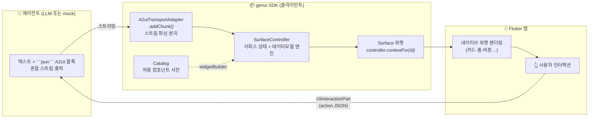
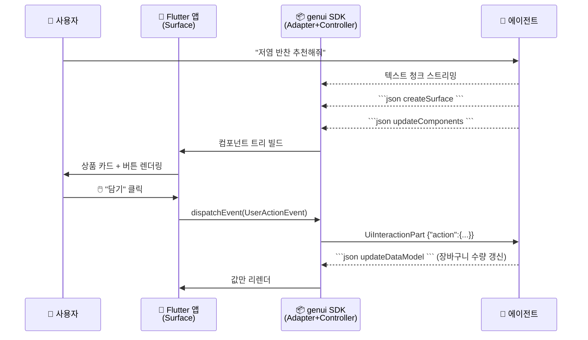
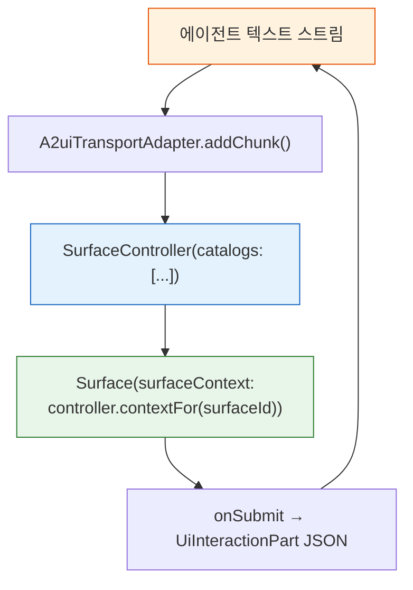
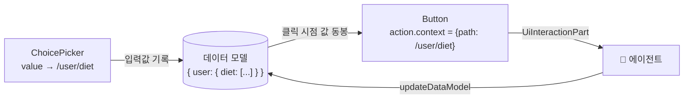
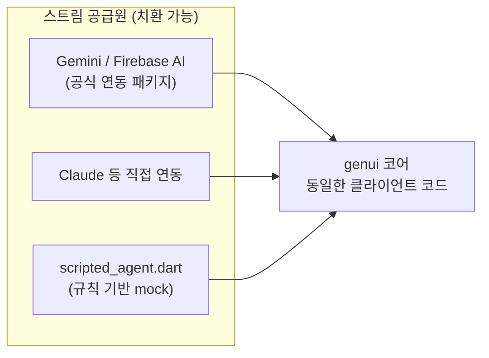
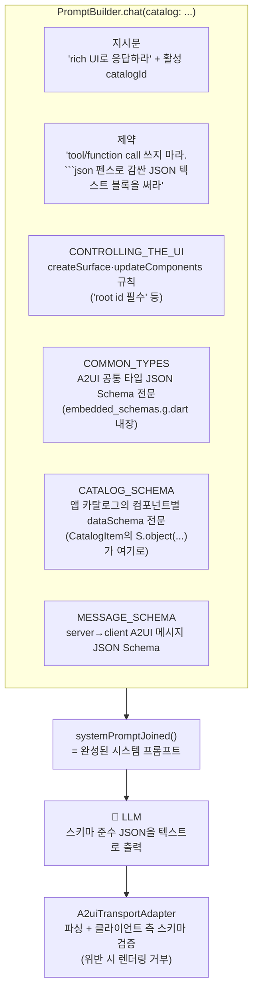

# Flutter GenUI SDK 정리

> **GenUI** = Google Flutter 팀의 **생성형 UI(Generative UI) SDK**
> LLM 에이전트가 텍스트가 아닌 **UI 명세(JSON)를 스트리밍**하면, Flutter 앱이 이를 **실시간 네이티브 위젯**으로 렌더링한다.

| 항목 | 내용 |
|---|---|
| 패키지 | [`genui`](https://pub.dev/packages/genui) ([github.com/flutter/genui](https://github.com/flutter/genui)) |
| 기준 버전 | **genui 0.10.2** / **A2UI 프로토콜 v0.9** (본 문서 실측 기준) |
| 상태 | ⚠️ **Highly Experimental** — 마이너 버전마다 breaking change 잦음 |
| 함께 쓰는 패키지 | `json_schema_builder` (스키마 DSL), `flutter_markdown_plus` |
| 이 저장소의 프로토타입 | `genui_agent/` — 대화형 쇼핑몰 GenUI 데모 |

---

## 1. 한눈에 보는 전체 구조



**핵심 루프**: 에이전트가 UI를 그리고 → 사용자가 조작하면 → 그 액션이 JSON으로 에이전트에 돌아가 → 다음 UI를 결정한다. **UI 이벤트가 대화 루프의 일급 시민.**

---

## 2. A2UI 프로토콜 — 에이전트 ↔ 앱의 계약

에이전트는 일반 텍스트 사이에 ` ```json ` 코드블록으로 A2UI 메시지를 섞어 보낸다.

### 2.1 메시지 3종 (에이전트 → 앱)

| 메시지 | 역할 | 비고 |
|---|---|---|
| `createSurface` | 새 UI 영역(서피스) 선언 | `surfaceId`, `catalogId`, `sendDataModel` |
| `updateComponents` | 컴포넌트 트리 정의/갱신 | flat 리스트 + id 참조, **루트 id는 반드시 `"root"`** |
| `updateDataModel` | 데이터모델의 특정 path 값만 갱신 | UI 재구성 없이 값만 변경 |

```json
{"version":"v0.9","createSurface":{"surfaceId":"s1","catalogId":"shop","sendDataModel":true}}
```

```json
{"version":"v0.9","updateComponents":{"surfaceId":"s1","components":[
  {"id":"root","component":"Column","children":["title","btn"]},
  {"id":"title","component":"Text","text":"추천 상품"},
  {"id":"btn","component":"Button","label":"담기","action":{"name":"add_cart"}}
]}}
```

```json
{"version":"v0.9","updateDataModel":{"surfaceId":"s1","path":"/cart/count","value":3}}
```

### 2.2 역방향 (사용자 → 에이전트): `UiInteractionPart`

```json
{"version":"v0.9","action":{"name":"add_cart","context":{"productId":"p-01"}}}
```

### 2.3 한 턴의 시퀀스



---

## 3. 클라이언트 파이프라인 (Dart 코드 관점)



| 구성요소 | 역할 |
|---|---|
| `A2uiTransportAdapter` | LLM 출력 청크에서 텍스트/A2UI JSON 분리·파싱 (불완전 JSON도 스트리밍 처리) |
| `SurfaceController` | 여러 서피스의 생명주기·컴포넌트 트리·데이터모델을 관리하는 엔진 |
| `Surface` 위젯 | 채팅 말풍선 등 원하는 위치에 배치 → 해당 서피스를 Flutter 위젯으로 빌드 |

---

## 4. 카탈로그 — "에이전트가 쓸 수 있는 위젯 사전" 🗂️

에이전트는 **앱이 허용한 컴포넌트만** 사용할 수 있다. 카탈로그가 GenUI의 **안전장치이자 확장 지점**.

### 4.1 기본 제공 컴포넌트 (`BasicCatalogItems`)

| 분류 | 컴포넌트 |
|---|---|
| 레이아웃 | `Column` `Row` `List` `Tabs` `Card` `Divider` `Modal` |
| 표시 | `Text` `Image` `Icon` `Video` `AudioPlayer` |
| 입력 | `Button` `TextField` `CheckBox` `Slider` `ChoicePicker` `DateTimeInput` |

### 4.2 커스텀 컴포넌트 정의

```dart
CatalogItem(
  name: 'ProductCard',
  dataSchema: S.object(properties: {          // json_schema_builder DSL
    'title': S.string(),
    'price': S.integer(),
  }),
  widgetBuilder: (itemContext) {
    final data = itemContext.data;            // props 접근
    return Card(
      child: ElevatedButton(
        onPressed: () => itemContext.dispatchEvent(
          UserActionEvent(name: 'add_cart', ...),  // 이벤트 → 에이전트
        ),
        child: Text(data['title']),
      ),
    );
  },
)
```

```dart
// 카탈로그 합성 패턴
final catalog = BasicCatalogItems.asCatalog()
    .copyWith(newItems: [productCard, ...], catalogId: 'shop');
```

> 💡 `dataSchema`는 검증용이면서 동시에 **LLM 프롬프트에 들어가는 명세**다.
> 에이전트는 이 스키마로 "이 앱에서 쓸 수 있는 컴포넌트와 props"를 학습한다.

---

## 5. 데이터 모델과 path 바인딩 🔗

컴포넌트 props에 리터럴 대신 `{"path": "/x/y"}` 바인딩을 넣으면 데이터모델을 참조한다.



- 입력 위젯 값 → 데이터모델에 기록
- Button의 action context에 path 바인딩 → **클릭 시점의 폼 값이 통째로 에이전트에 전달** (폼 제출 패턴)
- 에이전트는 `updateDataModel`로 화면 재구성 없이 값만 갱신

---

## 6. LLM 연동 — 모델 불가지론적 설계

`genui` 코어는 "**텍스트 스트림 in → UI out**"만 담당한다. 연결 방식은 자유:



> `genui_agent/` 프로토타입의 `scripted_agent.dart`는 mock이지만 LLM과 **동일한 "텍스트+```json``` A2UI" 스트림**을 내보내므로, 진짜 LLM으로 갈아끼워도 클라이언트 코드는 그대로다.

---

## 7. PromptBuilder — LLM에게 A2UI를 시키는 방법 📝

> ❓ **A2UI는 Claude/Gemini가 모델 차원에서 지원하는 규격인가?** → **아니다.**
> 순수 **프롬프트 엔지니어링**이다. genui의 `PromptBuilder`가 스키마를 내장한 시스템 프롬프트를 자동 생성하고, LLM은 그 지시대로 **텍스트로 JSON을 출력**할 뿐이다. 어떤 LLM이든(규칙 기반 mock조차) 이 형식의 텍스트만 내면 동작한다.

### 7.1 사용법

```dart
final systemPrompt = PromptBuilder.chat(catalog: shopCatalog).systemPromptJoined();
// → LLM 호출 시 system prompt로 전달
// → 스트리밍 응답 텍스트를 그대로 A2uiTransportAdapter.addChunk()에 공급
```

### 7.2 생성되는 시스템 프롬프트의 구성



| 섹션 | 내용 |
|---|---|
| 지시문 | rich UI 응답 요구 + 활성 `catalogId` 명시 |
| 제약 | "Do not use tools or function calls for UI generation. Use JSON text blocks. fenced with \`\`\`json" |
| CONTROLLING_THE_UI | 각 A2UI 메시지의 필수 속성 규칙 (`id: "root"` 필수 등) |
| OUTPUT_FORMAT | "VALID A2UI JSON object... valid and complete" |
| COMMON_TYPES / CATALOG_SCHEMA / MESSAGE_SCHEMA | **JSON Schema 전문이 프롬프트에 통째로 인라인** — "약속된 규격"의 실체 |

### 7.3 설계 포인트

- **의도적으로 tool use를 배제** (`TechnicalPossibilities` 기본값 전부 false): 텍스트와 UI JSON이 한 스트림에 섞여야 "답변 중간에 UI가 나타나는" 스트리밍 UX가 자연스럽기 때문. (Claude API 직접 연동 시 tool use / structured output으로 강제하는 변형도 가능)
- **허용 동작도 프롬프트로 제어** (`SurfaceOperations`): 채팅 기본값 `createOnly`면 "이전 턴 서피스를 수정하지 말고 새 서피스를 만들어라" 지시가 삽입됨. `updateDataModel`은 `dataModel: true`일 때만 등장.
- **스키마 준수는 지시일 뿐** — 최종 방어선은 클라이언트 검증(`schema_validation.dart`). 모델이 스키마를 어기면 렌더링 단계에서 거부된다.
- 카탈로그의 커스텀 컴포넌트 스키마가 자동으로 프롬프트에 포함되므로, **별도 프롬프트 작성 없이** 모델이 앱의 컴포넌트를 쓸 수 있다.

> 소스: `genui-0.10.2/lib/src/facade/prompt_builder.dart`

---

## 8. 실전 주의점 (0.10.2 실측) ⚠️

| # | 함정 | 대처 |
|---|---|---|
| 1 | **Experimental** — breaking change 잦고 문서 부족 | pub 캐시 소스가 가장 정확: `%LOCALAPPDATA%\Pub\Cache\hosted\pub.dev\genui-0.10.2` |
| 2 | `ChoicePicker` 반환값은 단일 선택이어도 **List** (`['저염']`) | String 캐스팅 금지, List로 처리 |
| 3 | 루트 컴포넌트 id는 **`"root"` 고정** | 다른 id면 렌더링 안 됨 |
| 4 | 스키마 정의에 별도 패키지 필요 | `json_schema_builder`의 `S.object(...)` DSL |

---

## 9. 언제 쓰나 🎯

| 적합 ✅ | 부적합 ❌ |
|---|---|
| 응답 형태를 미리 알 수 없는 **대화형 시나리오** | 화면이 고정된 정적 UI |
| 쇼핑 컨시어지 (상품 카드+필터+장바구니를 대화 중 생성) | 단순 Q&A 챗봇 (텍스트로 충분) |
| 여행 계획, 폼 기반 상담 등 | 성능·안정성이 최우선인 프로덕션 코어 화면 |

**요약**: 에이전트가 상황에 맞는 UI를 즉석에서 조립하되, **카탈로그로 디자인 시스템과 안전 범위를 앱이 통제**하는 구조.

---

## 부록: 참고 경로

- 프로토타입: `genui_agent/` (`lib/chat_session.dart`, `lib/scripted_agent.dart`, `lib/shop_catalog.dart`)
- 실행: `flutter run -d chrome --release` / 검증: `flutter test`
- genui 소스: `%LOCALAPPDATA%\Pub\Cache\hosted\pub.dev\genui-0.10.2\lib\`
  - 파서: `src/transport/a2ui_transport_adapter.dart`
  - 엔진: `src/engine/surface_controller.dart`
  - 기본 카탈로그: `src/catalog/basic_catalog_widgets/`
  - 프롬프트 생성: `src/facade/prompt_builder.dart`
