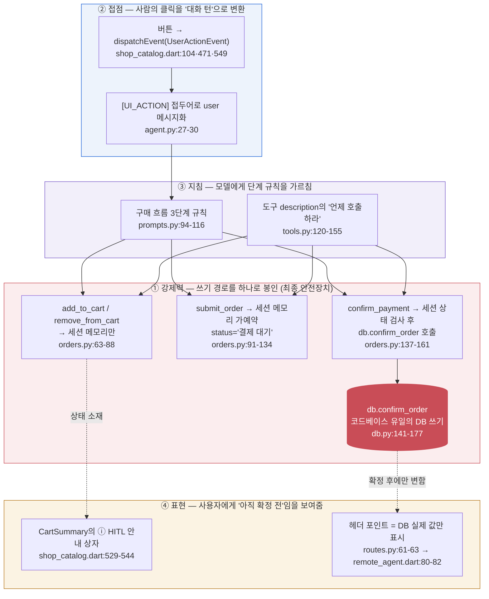
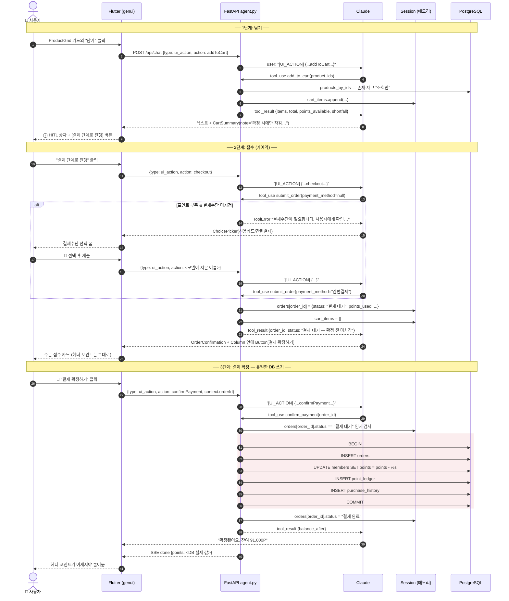
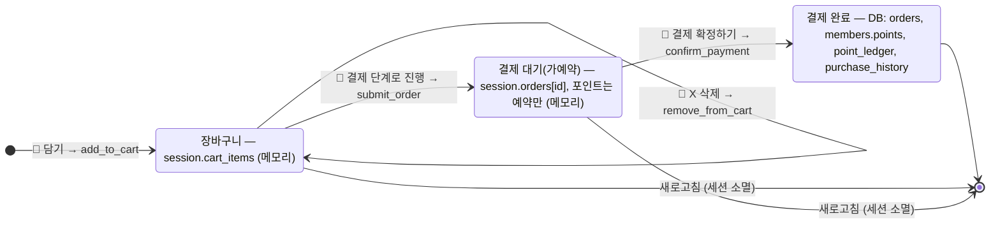
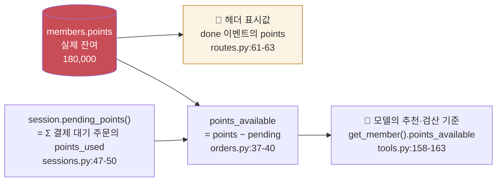

# HITL(Human-in-the-loop) — 코드 어디에 어떻게 구현되어 있나

> 대상: `shop_backend/` + `genui_agent/` (2026-10-14 기준). 전체 설계는 [architecture.md](architecture.md) 참조.
> 한 줄 요약: **"돈이 움직이는 DB 쓰기는 `db.confirm_order` 한 곳뿐이고, 거기까지 가려면 사람이 버튼을 세 번 눌러야 한다."**
> HITL은 특정 화면이 아니라, 아래 네 겹의 게이트가 겹쳐서 만들어지는 성질이다.

**읽는 법.** 위에서 아래로 갈수록 "강제력"이 세진다. ④와 ③은 어겨도 시스템이 깨지지 않는 **안내·지침**이고, ①이 실제로 **DB를 지키는 코드**다. 모델이 프롬프트를 무시하고 `confirm_payment`를 먼저 불러도, 세션에 `결제 대기` 주문이 없으면 `orders.py:139-141`의 ToolError로 막힌다.

---

## 1. 사람이 세 번 누르는 흐름 — 시퀀스로 보기

아래는 실제 데모 한 바퀴다. 🧑 표시가 **사람이 결정하는 지점(HITL 게이트)** 이고, 그 사이의 모든 일은 모델과 서버가 처리하되 **DB에는 쓰지 않는다.** DB 쓰기는 맨 아래 빨간 구간 한 번뿐이다.

주목할 점 세 가지.

- **3·4·5번**과 **13~20번** 사이에 `DB`로 가는 화살표가 "조회"뿐이다. 담기·접수는 전부 `Session` 객체(파이썬 dict/list)에만 기록된다.
- **alt 블록**: 결제수단이 없을 때 서버가 `ToolError`를 던지고, 그 메시지 자체가 "사용자에게 확인하라"는 지시다. 모델은 이를 읽고 ChoicePicker를 만들어 사람에게 되묻는다. 코드에 "포인트 부족이면 폼을 띄워라"는 분기가 없다. → `orders.py:100-106`
- **빨간 구간**이 코드베이스 전체에서 유일한 쓰기이고, 하나의 트랜잭션이다. → `db.py:141-177`

---

## 2. 주문의 상태 전이 — 어디까지가 메모리, 어디부터 DB인가

- `장바구니`·`결제 대기`는 **세션 메모리** 상태라 새로고침(= 재로그인 대용)으로 사라진다. 사용자가 확정 없이 떠나면 흔적이 없다. → `sessions.py:37-50`, `sessions.py:72-90`
- `결제 완료`만 DB에 남는다. 이후 `get_purchase_history`가 이 기록을 읽어 다음 추천의 근거로 쓴다.
- 전이의 화살표마다 🧑가 붙어 있다. **모델이 혼자서 다음 상태로 넘길 수 있는 전이가 하나도 없다.** 모델이 할 수 있는 것은 "다음 단계로 갈 버튼을 화면에 그려 주는 것"까지다.

---

## 3. "포인트가 두 개" — 왜 헤더가 안 줄어드는가

- 헤더는 **항상 DB 값**(`points`)만 보여준다. 접수를 해도 DB는 안 바뀌므로 숫자가 그대로다. 이것이 사용자에게 "아직 확정 전"임을 알려주는 가장 직관적인 신호다.
- 모델은 `points_available`(예약분 차감 후)로 추천과 검산을 한다. 그래서 접수 후 추가 추천을 하면 "남은 가용 포인트" 기준으로 계산하면서도, "헤더 포인트는 확정 시에만 줄어든다"고 안내할 수 있다. → `prompts.py:113-115`

---

## 4. 코드 맵 — 파일별로 무엇이 HITL인가

| 겹 | 역할 | 파일:라인 | 핵심 코드 |
|---|---|---|---|
| ① 강제력 | 담기/삭제는 조회만, 세션에 기록 | `shop_backend/app/orders.py:63-88` | `db.products_by_ids(...)` 후 `session.cart_items.append(...)` |
| ① 강제력 | 접수는 세션 가예약, 결제수단 없으면 사람에게 되묻게 ToolError | `orders.py:91-134` | `raise ToolError("…사용자에게 확인 후 payment_method에…")`, `session.orders[order_id] = {... "status": "결제 대기"}` |
| ① 강제력 | 확정은 세션 상태 검사 후 유일한 DB 쓰기 호출 | `orders.py:137-161` | `if order["status"] != "결제 대기": raise ToolError` → `db.confirm_order(...)` |
| ① 강제력 | 트랜잭션 1개로 주문·차감·원장·이력 기록 | `shop_backend/app/db.py:141-177` | `with conn.transaction(): INSERT orders / UPDATE members / INSERT point_ledger / INSERT purchase_history` |
| ① 강제력 | 미확정 상태는 인메모리, TTL·새로고침으로 소멸 | `shop_backend/app/sessions.py:37-50, 72-90` | `cart_items`, `orders`, `pending_points()` |
| ② 접점 | 버튼 → 이벤트 (코드 분기 없음) | `genui_agent/lib/shop_catalog.dart:104-112` (담기) · `471-479` (삭제) · `549-554` (결제 단계로) | `itemContext.dispatchEvent(UserActionEvent(name: 'checkout', ...))` |
| ② 접점 | 이벤트 → 타임라인 흔적 + 에이전트 전달 | `genui_agent/lib/chat_session.dart:90-94` | `surfaceController.onSubmit.listen(_onUiSubmit)` |
| ② 접점 | UiInteractionPart → `{type: ui_action}` 직렬화 | `genui_agent/lib/agent/remote_agent.dart:95-110` | `_serialize(message)` |
| ② 접점 | 클릭을 모델의 user 메시지로 | `shop_backend/app/agent.py:27-30` | `"[UI_ACTION] " + message["interaction"]` |
| ③ 지침 | 3단계 규칙, 확정 버튼을 Column으로 조립하라 | `shop_backend/app/prompts.py:94-116` | "접수 성공 시 … **'결제 확정하기 (데모)' Button**을 제공하라" |
| ③ 지침 | 도구별 "언제 호출하라", "이때만 차감" | `shop_backend/app/tools.py:120-155` | `submit_order`·`confirm_payment` description |
| ④ 표현 | ⓘ HITL 안내 상자 | `shop_catalog.dart:529-544` | `Text('ⓘ HITL  $note')` |
| ④ 표현 | 헤더는 DB 실제 값만 | `shop_backend/app/routes.py:61-63` → `remote_agent.dart:80-82` | `db.current_points(...)` → SSE `done {"points": …}` |

---

## 5. 자주 나오는 질문

**Q. 확정 버튼은 어느 위젯에 있나?**
OrderConfirmation 위젯(`shop_catalog.dart:572-644`)에는 버튼이 없다. 프롬프트(`prompts.py:106-108`)가 모델에게 "같은 서피스의 Column 안에 표준 `Button`을 넣어라"고 지시하고, 모델이 `action.event.name = "confirmPayment"`, `context.orderId`를 채워 조립한다. 즉 확정 버튼은 **모델이 만든 UI**다.

**Q. 모델이 프롬프트를 어기고 `confirm_payment`를 바로 부르면?**
`orders.py:139-141`에서 `session.orders`에 해당 주문이 없거나 상태가 `결제 대기`가 아니면 ToolError. DB는 건드리지 못한다. 최종 안전장치는 프롬프트가 아니라 서버 코드다.

**Q. "담기" 클릭을 서버가 직접 처리하면 더 빠르지 않나?**
그렇다. 하지만 이 데모의 검증 목표가 "UI 액션도 모델이 해석하는가"라서 의도적으로 라우팅 코드를 두지 않았다(architecture.md §5, §13). 실서비스라면 `addToCart`처럼 의미가 고정된 액션은 서버에서 직접 처리하고, 모델에게는 결과만 알려주는 절충이 합리적이다.

**Q. 실결제는?**
`confirm_payment`는 데모용 가상 결제다. 부족분의 `payment_method`는 기록만 하고 실제 PG 호출은 없다(`orders.py:148-160`의 "데모: 실결제 없음").
